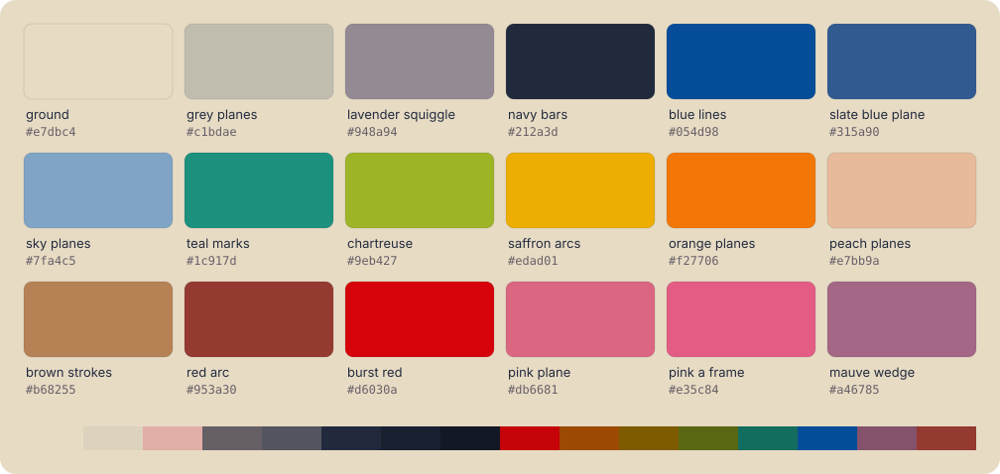

# renegade

A light color theme based on Julie Mehretu's *Retopistics: A Renegade Excavation*.



## Install

**Any app with a Base16 or Base24 template:** use [`dist/base16/renegade.yaml`](dist/base16/renegade.yaml) or [`dist/base24/renegade.yaml`](dist/base24/renegade.yaml) with the [Tinted Theming](https://github.com/tinted-theming) builders and templates (terminals, editors, Vim, and many more).

**VS Code:** copy `dist/vscode` to `~/.vscode/extensions/renegade-theme`, restart, then pick **Renegade** in *Preferences → Color Theme*.

**bb:**
```bash
mkdir -p ~/.bb/theme && cp -R dist/bb ~/.bb/theme/renegade && ~/.bb/bin/bb theme set renegade
```
Then set *Settings → Appearance → Theme* to Light.

## How it's built

- [`palette.json`](palette.json) is the source of truth: the 18 paints, with where each one comes from in the painting.
- [`lib/color.js`](lib/color.js) has the color logic: thinning a paint over the canvas, glazing it darker with ink until it meets a contrast target, and mapping any color onto the closest paint (used to repaint websites).
- [`lib/roles.js`](lib/roles.js) says what each color is for: background, text, accent, highlight, code colors, Base16 slots, terminal colors.
- [`build.js`](build.js) writes everything in `dist/`. [`sites/`](sites/) holds the website-repainting scripts that go into `dist/chrome-sites`.

To change the theme, edit `palette.json` or `lib/roles.js`, then run:
```bash
npm run build
```
It needs Node 18 or later and has no dependencies.

## License

The code is MIT licensed. The painting is Mehretu's; this repository contains only colors.
